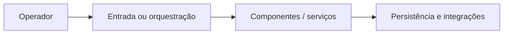

# Arquitetura — API-Fabricante-Revendedor

Stack identificada: Java Servlets, Maven, JSP e persistência relacional. Locais de referência: Dell/, fujioka/, ProdutosAPI/.

Este é um diagrama **conceitual**, não descreve todos os processos reais. Não reestruturar o projeto antes de validar contratos e dependências.

Existem arquivos .env rastreados em subprojetos; verificar imediatamente se contêm credenciais e rotacionar segredos se necessário. Projeto não é produção.
